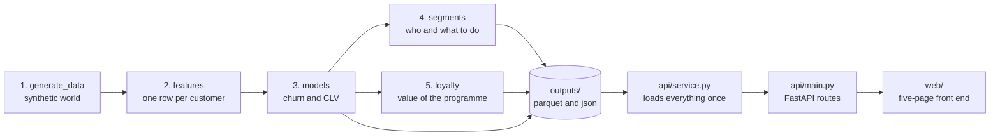
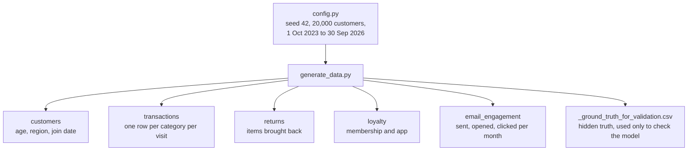
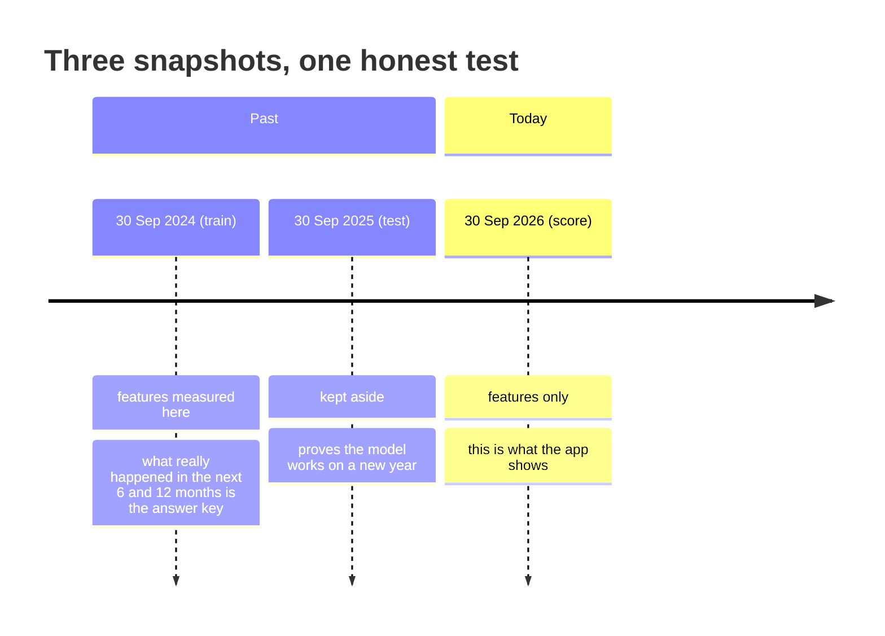
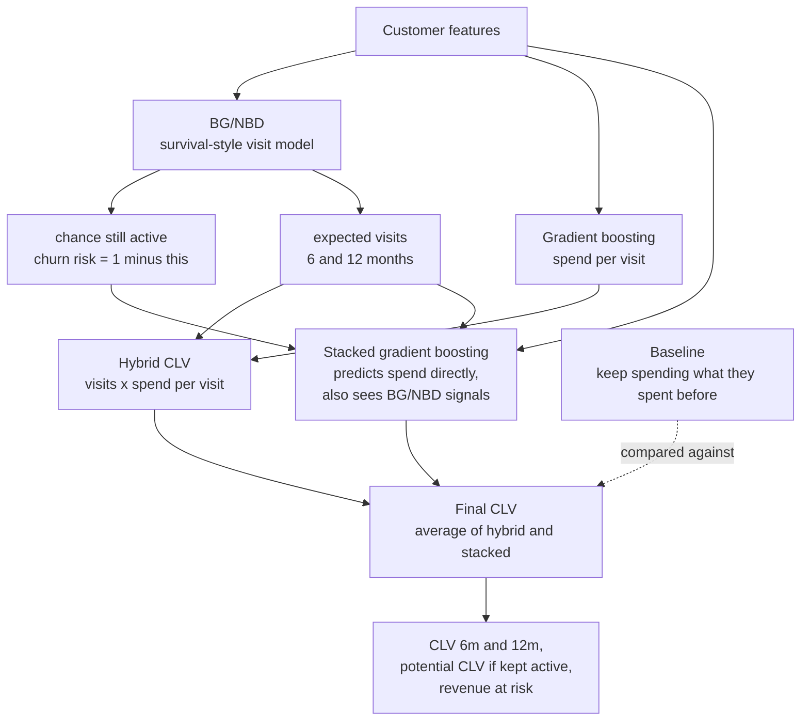
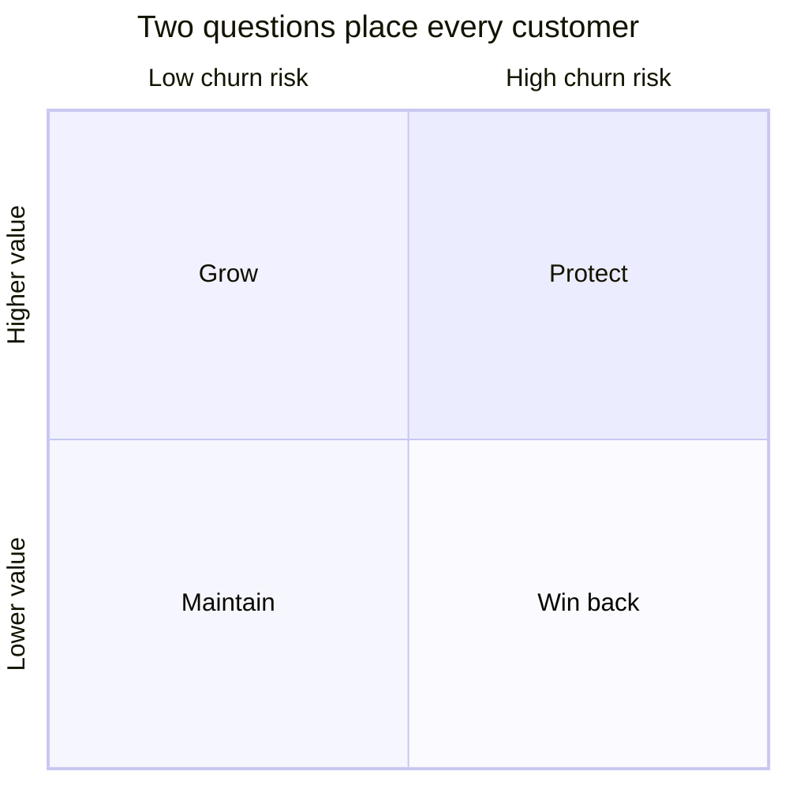
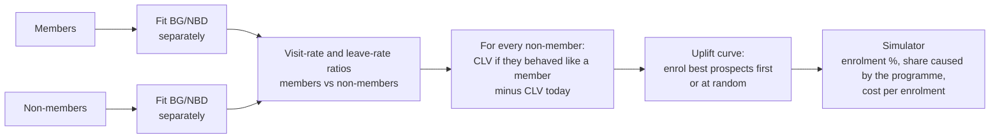
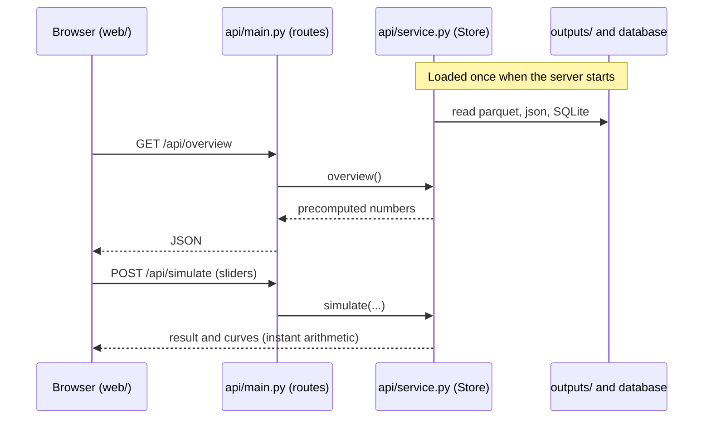
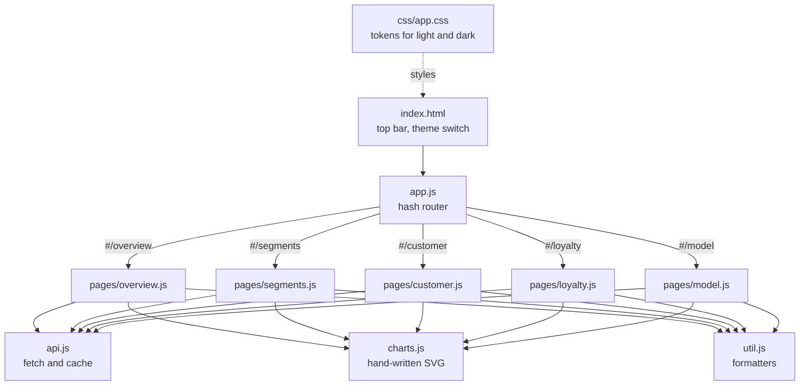
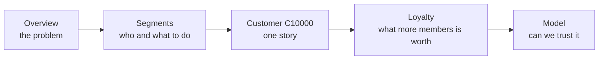

# Customer Lifetime Value for Primark (synthetic data)

An end-to-end, offline demo that predicts what each customer will be worth over the next 6 and 12 months, finds the high-value customers who are quietly drifting away, and recommends what to do about each group.

> **All data in this project is synthetic.** It is generated by code in this repository, modelled on Primark-style UK and Ireland shopping behaviour. It contains no real customers and no real Primark data. Campaign save rates, campaign costs and loyalty effects are illustrative assumptions, labelled as such in the app.

---

## 1. The business question

Primark has many customers it can identify through the loyalty and app programme, and little visibility of which ones are about to stop shopping. This project answers three questions for a board audience:

| Question | Where it is answered |
|---|---|
| How much is each customer worth over the next 6 and 12 months, and how much of that is at risk? | Overview, Customers |
| Who should we act on first, and what should we do? | Segments, Customers |
| What would a bigger loyalty programme be worth? | Loyalty |

---

## 2. Quick start (Windows, VS Code, offline)

Prerequisite: Python 3.12 (3.10 to 3.12 all work).

```powershell
# 1. open the folder in VS Code, then open a terminal (Ctrl+`)
python -m venv .venv
.venv\Scripts\Activate.ps1          # if blocked: Set-ExecutionPolicy -Scope CurrentUser RemoteSigned
pip install -r requirements.txt

# 2. build everything (about a minute): data, features, models, segments, loyalty
python run_all.py

# 3. start the app
uvicorn api.main:app --reload
```

Open **http://127.0.0.1:8000**. The interactive API test page is at **http://127.0.0.1:8000/docs**.

Handy variations:

| Command | What it does |
|---|---|
| `python run_all.py --skip-data` | Re-runs models, segments and loyalty on the existing synthetic data |
| `python check.py` | Confirms the Python environment is ready |
| `python -m src.models` | Re-runs just one stage (every stage in `src/` can run alone) |

Nothing needs the internet once the packages are installed.

---

## 3. How the repository works

### 3.1 The big picture



Plain-text version of the same flow, in case your viewer does not draw diagrams:

```
 src/generate_data.py  ->  data/primark_clv.db           (5 tables, 20,000 customers)
 src/features.py       ->  outputs/features_*.parquet    (one row per customer, 3 snapshots)
 src/models.py         ->  outputs/predictions_*.parquet, metrics.json, models/
 src/segments.py       ->  outputs/customer_segments.parquet, segment_summary.json
 src/loyalty.py        ->  outputs/loyalty_analysis.json, loyalty_uplift.parquet
 api/service.py        ->  reads outputs/ and the database, answers questions
 api/main.py           ->  HTTP routes (/api/...) and serves web/
 web/                  ->  what the audience sees in the browser
```

**Two rules explain the whole design.**
1. **Everything heavy is computed ahead of time** by `run_all.py`. The app only reads results, so every click in the demo is instant.
2. **Each stage reads the previous stage's files and writes its own.** You can re-run any stage alone, and you can inspect any intermediate file.

### 3.2 Folder map

```
primark-clv/
├── run_all.py              one command that runs the five stages in order
├── check.py                environment check
├── requirements.txt        Python packages
├── README.md               this file
├── DEMO_SCRIPT.md          the 15-minute live demo, minute by minute
├── src/                    the data science (batch, runs once)
│   ├── config.py           every setting in one place (seed, dates, sizes, categories)
│   ├── generate_data.py    Stage 1: builds the synthetic dataset
│   ├── features.py         Stage 2: turns raw tables into one row per customer
│   ├── models.py           Stage 3: churn probability, expected visits, CLV
│   ├── segments.py         Stage 4: four segments, reasons, campaign economics
│   └── loyalty.py          Stage 5: members vs non-members and the uplift curve
├── data/                   created by Stage 1 (SQLite database and CSV copies)
├── outputs/                created by Stages 2 to 5 (everything the app reads)
├── api/                    the server (runs while you demo)
│   ├── service.py          loads outputs, holds the logic, answers questions
│   └── main.py             thin FastAPI routes plus static file serving
└── web/                    the front end (plain HTML, CSS, JavaScript, no build step)
    ├── index.html          page shell: top bar, theme switch, footer
    ├── css/app.css         design tokens for light and dark, all components
    └── js/
        ├── app.js          router, theme switch, page titles
        ├── api.js          calls the server
        ├── charts.js       hand-written SVG charts (works offline)
        ├── util.js         formatting and shared helpers
        └── pages/          overview, segments, customer, loyalty, model
```

### 3.3 Stage 1: the synthetic world (`src/generate_data.py`)

Builds five tables in `data/primark_clv.db` (SQLite) and as CSV copies.



Each customer has their own visit rate and their own chance of quietly leaving after each visit (the classic BG/NBD story). Visits are more likely at weekends and in busy months. Loyalty members visit slightly more and leave slightly less, which is an assumption stated openly. One hand-crafted customer, **C10000**, is the guided-demo character: a 38-year-old loyal family shopper in Manchester whose gaps between visits stretched from 26 to 31 to 38 to 60 days.

The same seed always produces the same data.

### 3.4 Stage 2: features (`src/features.py`)

Models cannot read thousands of receipts, so each customer's history is summarised into about 50 measures: recency, frequency, tenure, average basket, category shares, return rate, loyalty and app status, email behaviour and more (see the data dictionary on the Model page).

It is built at **three snapshots** so the model is tested on a future it never saw:



A snapshot only uses information that existed on its date, so nothing from the future leaks in. Spend is counted **net of returns**.

### 3.5 Stage 3: the models (`src/models.py`)

> CLV over the next 6 or 12 months = expected visits x expected spend per visit



- **BG/NBD** uses three numbers per customer (repeat visits, time of last visit, customer age) to estimate the chance they are still active and how many visits to expect. We use a small variant that lets a customer leave right after the first visit, because that is common in retail.
- **Gradient boosting** (LightGBM, with a scikit-learn fallback if LightGBM is not installed) learns spend per visit from basket size, categories, returns, loyalty and email behaviour.
- **Final CLV** averages two views for stability.
- **Potential CLV** is the value if the customer stays active. **Revenue at risk = potential CLV x churn risk.**

How the models are judged: the baseline and every model are scored on the held-out year with average miss per customer (MAE), total forecast against actual (bias), ranking quality, and churn detection (AUC). On the reference run, the final 12-month model misses by about £38 per customer against about £87 for the baseline, with total forecast within a few percent of actual and a churn detection score of about 0.85. Your numbers will differ slightly with the model engine used.

Because the data is synthetic, the generator's hidden true settings are known, and the Model page shows that the BG/NBD parameters the model learned land close to them.

### 3.6 Stage 4: segments (`src/segments.py`)



| Segment | Meaning | Play |
|---|---|---|
| **Protect** | High value, likely to be slipping away | Personal outreach before they lapse |
| **Grow** | High value, still active | Reward and deepen, no discounts |
| **Win back** | Lower value, likely gone | Low-cost reactivation, email first |
| **Maintain** | Lower value, still active | Keep warm, no extra spend |

High value means the top 30% of customers by potential 12-month CLV. High risk means a churn risk of 50% or more. For every customer the stage writes plain-English reasons ("last visit 102 days ago, 5.1 times their usual gap") and a suggested next action. For each segment it estimates what a campaign could recover, using **illustrative** save rates and costs defined at the top of `segments.py`. Replace them with Primark's real response and cost data before using the numbers for decisions.

### 3.7 Stage 5: loyalty value (`src/loyalty.py`)



**Honesty note.** Members and non-members differ in other ways too, because keener shoppers are more likely to join. The result is an **association, not proof of cause**. The simulator therefore lets the audience choose how much of the gap they believe the programme really causes (default 50%).

### 3.8 The server (`api/`)



| Route | Used by |
|---|---|
| `GET /api/overview` | Overview page |
| `GET /api/segments` | Segments page |
| `GET /api/customers`, `GET /api/customers/{id}` | Customers page and segment lists |
| `GET /api/demo` | The guided-demo customer, C10000 |
| `GET /api/loyalty`, `POST /api/simulate` | Loyalty page |
| `GET /api/model` | Model page |
| `GET /api/health` | Quick check that the server is up |

`main.py` contains only routes. All logic is in `service.py`, so it can be tested without a web server.

### 3.9 The front end (`web/`)

No framework and no build step: plain ES modules that the browser loads straight from the server.



- **Theme:** white by default, dark on the switch. All colours are CSS variables under `:root[data-theme]`, so charts follow the theme without redrawing. The choice is remembered in the browser.
- **Charts:** hand-written SVG (no chart library), so the demo works with the network off.
- **Colours:** segment colours are fixed (Protect orange, Grow green, Win back blue, Maintain grey) and were checked for colour-blind separation in both themes.
- **Motion:** one entrance animation and the lines that connect the Overview bar to the segment tiles. Both respect the reduced-motion setting.

### 3.10 The demo path



The full minute-by-minute script is in `DEMO_SCRIPT.md`.

---

## 4. Files you can open to check any claim

| File | What is in it |
|---|---|
| `outputs/metrics.json` | Scorecard for every model, calibration tables, feature importance |
| `outputs/segment_summary.json` | Segment sizes, value, campaign economics, the grouping rules |
| `outputs/loyalty_analysis.json` | Member vs non-member behaviour and the uplift curve |
| `outputs/feature_dictionary.csv` | What each measure means |
| `outputs/predictions_score.parquet` | Every customer's prediction as of today |

---

## 5. Limits worth stating out loud

- The data is synthetic. Real Primark data would need the same five tables, and real behaviour will not match a simulation exactly.
- Only customers identified through the loyalty programme, app or email are visible. In-store shoppers who are never identified are not in the data.
- Campaign effects, costs and the loyalty causal share are assumptions, not measurements. They should be replaced with Primark's own test results.
- BG/NBD assumes purchase behaviour is steady over time. It does not model one-off events such as a store closure or a major promotion.

## 6. Troubleshooting

| Symptom | Fix |
|---|---|
| `Activate.ps1 cannot be loaded` | `Set-ExecutionPolicy -Scope CurrentUser RemoteSigned`, then activate again |
| `python` not found | Use the full path to `python.exe` to create the venv, then use the venv from then on |
| Page says "Something went wrong loading this page" | The server stopped. Restart `uvicorn api.main:app --reload` |
| Numbers look stale after a model change | Run `python run_all.py --skip-data`, then restart the server |
| Charts or styles look unchanged | Hard refresh with Ctrl+F5 |
| Diagrams show as code in VS Code | Install the extension "Markdown Preview Mermaid Support", or use the plain-text flow in section 3.1 |
